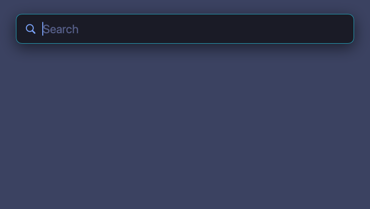

# Pennyworth

A keyboard launcher for macOS in the spirit of Alfred, built to be bent to your own
workflow. Native Swift (AppKit + SwiftUI), no dependencies.



## Features

- **Fuzzy app search** that matches words in any order and learns from what you pick.
- **Firefox bookmarks** by title, URL, folder, tag or keyword, kept in sync while Firefox runs.
- **Calculator and unit conversions**: `24*7`, `3 GB in MB`, `100 f to c`.
- **Themes**: seven built in (Tokyo Night by default), previewed live, or write your own in JSON.
- **One config file** whose changes apply as soon as you save.
- **Stays out of the way**: lives in the menu bar, no Dock icon, no permissions to grant.

## Quick start

You need macOS 14 or later and the Xcode Command Line Tools (`xcode-select --install`).
Full Xcode isn't required.

```sh
git clone https://github.com/thebluearchive/pennyworth.git
cd pennyworth
make install
```

This builds Pennyworth, copies it to `~/Applications` and launches it. Press **⌥Space**
and start typing.

To start it at login, add it under System Settings → General → Login Items.

> **Alfred users:** Alfred also defaults to ⌥Space and doesn't claim the hotkey
> exclusively, so both would open. Give one of them a different [hotkey](#configuration).

## Usage

| Key | Action |
| --- | --- |
| ⌥Space | Show / hide (configurable) |
| ↑ ↓ or ⌃N ⌃P / ⌃J ⌃K | Move selection |
| ↩ | Open |
| ⌘↩ | Reveal app in Finder · copy bookmark URL |
| ⌘1 – ⌘9 | Open the nth visible result |
| ⇥ | Autocomplete the selected result |
| ⎋ | Close |

### Apps

Type part of an app's name. Multi-word queries match in any order.

Pennyworth learns from what you open. Pick Chrome after typing `c`, and Chrome ranks
higher for `c` next time. Picks fade over a couple of months. To reset them, choose
**Forget Learned Rankings** from the menu bar menu. They're stored in
`~/Library/Application Support/Pennyworth/knowledge.json`.

### Firefox bookmarks

Type `b`, a space, then your search: `b vento`. Bookmarks match by title, URL, folder,
tags and Firefox keyword, and an exact keyword match ranks first. ↩ opens the bookmark in
Firefox and ⌘↩ copies its URL.

### Calculator and units

Type an expression (`24*7`, or `= 24*7`) or a conversion (`3 GB in MB`). ↩ copies the
answer and ⌘↩ copies the whole line. ⇥ puts `= <answer>` back in the search field so you
can keep calculating.

- **Operators:** `+ - * / % ^ !` and parentheses
- **Functions:** `sqrt`, `log`, `sin`, `round`, `min`/`max` and friends
- **Constants and number formats:** `pi`, `e`, hex (`0xff`), binary (`0b101`)
- **Units:** data, length, mass, volume (US), temperature, time, speed, area, energy and
  angles. For data, `GB` is 10⁹ bytes, `GiB` is 2³⁰ bytes and `Mb` is megabits.

### Themes

Type `theme` and a space (or `theme` then ↩) to browse themes. The selected theme is
previewed live, and ↩ applies it. Add text to filter the list: `theme sto`. You can also
switch themes from the menu bar icon.

## Configuration

Pennyworth reads `~/.config/pennyworth/config.json` (or `$XDG_CONFIG_HOME/pennyworth`).
Every key is optional, and changes apply as soon as you save the file. Problems with the
config or theme files are listed in the menu bar menu.

```json
{
  "theme": "tokyo-night",
  "hotkey": "option+space",
  "maxVisibleResults": 8,
  "applicationFolders": ["~/Developer/Apps"],
  "firefoxBookmarks": true,
  "bookmarksKeyword": "b"
}
```

| Key | Description |
| --- | --- |
| `theme` | Id of the active theme. |
| `hotkey` | `+`-separated modifiers (`cmd`, `option`/`alt`, `ctrl`, `shift`) and a key (`a`–`z`, `0`–`9`, `space`, `return`, `tab`, `f1`–`f20`, punctuation). |
| `maxVisibleResults` | How many results to show at once. |
| `applicationFolders` | Folders to search in addition to `/Applications`, `/System/Applications`, `~/Applications` and the system CoreServices apps. |
| `firefoxBookmarks` | Set to `false` to turn off bookmark search. All Firefox profiles are read, default profile first. |
| `bookmarksKeyword` | What to type before a bookmark search. Set to `""` to mix bookmarks into every search. |

## Custom themes

Built in: Tokyo Night, Tokyo Night Storm, Tokyo Night Moon, Tokyo Night Day,
Catppuccin Mocha, Dracula and Nord.

Add your own as JSON files in `~/.config/pennyworth/themes/`. The file name is the theme
id. A file named after a built-in theme (such as `tokyo-night.json`) replaces it.

The easiest way to start is to extend an existing theme and override a few colors:

```json
{
  "name": "Tokyo Night Purple",
  "extends": "tokyo-night",
  "colors": { "accent": "#bb9af7", "border": "#bb9af7" },
  "cornerRadius": 14
}
```

A theme without `extends` must set `appearance` (`"dark"` or `"light"`) and every color
below. Colors are `#RRGGBB` or `#RRGGBBAA`. `cornerRadius` (default 12) and `borderWidth`
(default 1) are optional.

| Color | Used for |
| --- | --- |
| `background` | Window background |
| `border` | Window outline |
| `separator` | Line under the search field |
| `text` / `secondaryText` | Result titles / subtitles |
| `placeholder` | Empty search field hint |
| `accent` | Search icon, caret, symbol icons |
| `match` | Characters matching the query |
| `selectionBackground` / `selectionText` / `selectionSecondaryText` | Selected row |

## Development

### Building

| Command | What it does |
| --- | --- |
| `make build` | Compile with SwiftPM |
| `make test` | Run the unit tests |
| `make app` | Build `dist/Pennyworth.app` |
| `make run` | Build the app and launch it, replacing any running copy |
| `make install` | Build the app, copy it to `~/Applications` and launch it |
| `make demo` | Re-render `docs/demo.gif` (needs Python 3 with Pillow) |
| `make clean` | Remove `.build` and `dist` |

The Makefile uses SwiftPM's native build system, because the newer default fails on
machines with a malformed SDK in `/Library/Developer/CommandLineTools/SDKs`. If your
toolchain is fine, override it with `make SWIFT_FLAGS=`.

### Project layout

```
Sources/PennyworthCore   UI-free engine: fuzzy matching, providers, themes, config
Sources/Pennyworth       The app: panel, hotkey, SwiftUI views, menu bar
Tests/PennyworthCoreTests
```

Only `PennyworthCore` has unit tests, so keep logic there and leave the app target as
a thin UI layer.

### Adding a result type

Results come from `SearchProvider`s. The `SearchEngine` queries them concurrently and
ranks their results by score. A provider with a `keyword` is searched only when the query
starts with that word and a space, and then exclusively; otherwise it can offer
`suggestions`.

To add a new kind of result, implement `SearchProvider` and register it in
`AppDelegate.updateEngine()`.

### Debug flags

The app binary (`dist/Pennyworth.app/Contents/MacOS/Pennyworth`) accepts:

| Flag | Effect |
| --- | --- |
| `--search <query>` | Print ranked results and exit |
| `--show [query]` | Open the launcher at startup |
| `--theme <id>` | Use a theme without saving it |
| `--type <text>` | Type into the launcher one key at a time; `↓ ↑ ⇥ ↩` are sent as keys |
| `--type-interval <ms>` | Set the pace for `--type` |
| `--snapshot <file.png>` | Render the launcher to an image and quit (no screen recording permission needed) |

With `--type` or `--snapshot`, the panel is drawn off-screen and never takes keyboard
focus, so scripted runs don't interfere with whatever you're typing. For example,
`--type "fire↓" --snapshot /tmp/out.png` reproduces typing and then moving the selection.
